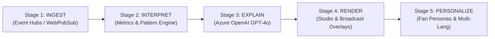

# PitchPulse AI: The Synthetic Match Insights Engine for Premier League Studio
## Master Architecture, Technical Specification & Implementation Plan

> **Hackathon Track:** Inside the Game Developer Hackathon  
> **Platform Target:** Microsoft Azure (Azure OpenAI, Azure Event Hubs, Azure Stream Analytics, Azure AI Translator, Azure Container Apps)  
> **Focus:** Real-time explainable football intelligence, broadcast overlays, and personalized viewer streams.

---

## 1. System Vision & Problem Statement

Modern football broadcasts overwhelm casual fans with raw statistics (e.g., *72% possession*, *14 shots*) while leaving tactical analysts starved for spatial and situational context. Broadcasters report **what** happened, but rarely explain **why it matters in real-time**.

**PitchPulse AI** solves this with an end-to-end 5-stage pipeline running on Azure that ingests synthetic high-frequency match events, interprets them into deep situational metrics, explains tactical narratives using Azure OpenAI (GPT-4o), renders broadcast-ready overlays, and personalizes the experience across four distinct viewer personas and multiple global languages.



---

## 2. Azure Service Mapping & Hybrid Architecture

To ensure zero friction during local development and maximum readiness for Azure deployment, the architecture implements a **Hybrid Service Provider Pattern**: every Azure component runs against real Azure resources when credentials are provided in `.env`, or gracefully operates in high-fidelity local emulation mode.

| Hackathon Requirement | Azure Cloud Service | Local Dev / Emulation Mode | Purpose |
| :--- | :--- | :--- | :--- |
| **Stage (a) Ingest** | **Azure Event Hubs** (Kafka API) & **Azure Web PubSub** | High-throughput AsyncIO Event Queue & WebSocket Hub | Ingests 20-50 synthetic events/sec with sub-50ms latency |
| **Stage (b) Interpret** | **Azure Stream Analytics** & **Azure Cache for Redis** | In-Memory Sliding Window State Aggregator | Calculates Control vs. Chaos, Pass Difficulty, & Speed alerts |
| **Stage (c) Explain** | **Azure OpenAI Service** (GPT-4o / GPT-4o-mini) | Structured Prompt Engine with Azure Fallback / Replay Cache | Generates tactical context, milestone calls, and "Why it Matters" |
| **Stage (d) Render** | **Azure Container Apps** / **Azure Static Web Apps** | React 18 + Vite + Tailwind CSS Server | Hosts Studio Director Dashboard & Alpha-Transparent Overlay Feed |
| **Stage (e) Personalize** | **Azure Cosmos DB** (Vector Search + NoSQL) | JSON Vector & Profile Store | Stores player profiles, team tactical tendencies, & fan preferences |
| **Multi-Language** | **Azure AI Translator** | Multilingual Prompt Routing & Localized Dictionary Engine | Translates insights on-the-fly into EN, ES, FR, AR, JA |

---

## 3. The 5-Stage Pipeline Deep Dive

### Stage A: Ingestion (Synthetic Match Data)
The engine consumes football-realistic event streams based on an extended Opta/StatsBomb coordinate model ($105\text{m} \times 68\text{m}$ pitch):
* **Event Types:** `pass`, `shot`, `tackle`, `interception`, `pressure`, `dribble`, `turnover`, `foul`, `goal`.
* **Telemetry Fields:**
  - Spatial coordinates: $(x, y) \to (x_{end}, y_{end})$.
  - Physical metrics: `ball_speed_kmh`, `shot_speed_kmh`, `distance_meters`, `airborne`.
  - Tactical context: `under_pressure`, `pressure_intensity` ($0.0 - 1.0$), `opponents_in_passing_lane`.
  - Player metadata: ID, Name, Jersey, Tactical Position (`GK`, `CB`, `FB`, `DM`, `CM`, `W`, `ST`).

### Stage B: Interpretation (Mathematical & State Engine)
Raw events are processed into real-time analytical states:
1. **Pass Difficulty Rating (PDR):**
   $$\text{PDR} = \min\left(1.0, \; \frac{D}{40} \times 0.35 + P_{\text{intensity}} \times 0.35 + N_{\text{opp}} \times 0.15 + (1.0 - \text{AngleFactor}) \times 0.15\right)$$
   Where $D$ is distance, $P_{\text{intensity}}$ is opponent pressure, and $N_{\text{opp}}$ is players cutting the passing lane.
2. **Control vs. Chaos Index (CCI):**
   Calculated over a rolling 3-minute sliding window:
   $$\text{CCI} = \frac{\text{Possession Progression} + \text{Pass Success \%}}{2} - \frac{\text{Turnover Rate} + \text{Transition Directness}}{2}$$
   - Score near $+1.0$: **High Tactical Control** (e.g. Manchester Blue settled positional dominance).
   - Score near $-1.0$: **End-to-End Chaos** (high transition rate, frantic turnovers, counter-attacks).
3. **Speed & Distance Milestone Triggers:**
   - Shot speed $> 100\text{ km/h} \implies$ Trigger "Rocket Shot" lower-third alert.
   - Ball speed on cross $> 70\text{ km/h} \implies$ Trigger "Whip Delivery" alert.
   - Sprint distance $> 31\text{ km/h} \implies$ Trigger "Speed Burst" player badge.
4. **Auto-Eventing Simulation Module:**
   Simulates a computer vision model inference stream (YOLOv8 + ByteTrack) that automatically infers pass completions and velocities from continuous player trajectory data.

### Stage C: Explainability ("Why It Matters" Engine)
Rather than superficial commentary, Azure OpenAI runs with a strict structured output schema (`MatchInsight`):
* **Headline:** Punchy broadcast lower-third title (max 6 words).
* **Tactical Context:** What tactical dynamic caused this moment (e.g., *overloaded right half-space*, *failed mid-block trap*).
* **Why It Matters:** The forward-looking significance (e.g., *forces the defending manager to alter full-back spacing*).
* **Momentum Impact:** Quantified shift in match momentum ($ -100 $ to $+100$).

### Stage D: Rendering (Studio & Broadcast Displays)
1. **Studio Director Dashboard (`Studio Director` mode):**
   - Live 2D pitch radar with animated ball vector, player positioning, and target reticles.
   - Real-time Control vs. Chaos gauge and possession momentum graph.
   - Live play-by-play commentary ticker combined with AI Explainable Insight cards.
   - Interactive event controls: Pause/Resume, Reset, and playback speed ($1\times$, $2\times$, $5\times$).
2. **Broadcast Overlay Feed (`Broadcast Overlay` mode):**
   - Clean, chroma-key / alpha-transparent web interface.
   - Auto-expands modern broadcast lower-thirds when key events occur.
   - Synchronized match clock and scorebug with integrated AI insight badges.

### Stage E: Personalization (4 Viewer Personas & Global Languages)

```
┌────────────────────────────────────────────────────────────────────────┐
│ ACTIVE VIEWING PERSONA                                                │
├────────────────────┬────────────────────┬─────────────────────────────┤
│ 1. Casual Fan      │ "Story & Drama"    │ Simplified terms, analogies │
│ 2. Tactical Analyst│ "The Chalkboard"   │ PPDA, half-spaces, lines    │
│ 3. Fantasy Scout   │ "FPL Maximizer"    │ xG, xA, BPS, cleansheet odds│
│ 4. Player Cam      │ "Spotlight Mode"   │ 100% focused on chosen star │
└────────────────────┴────────────────────┴─────────────────────────────┘
```

* **Multi-Language Selector:** Instant client toggle for English, Spanish, French, Arabic, and Japanese powered by Azure AI Translator and multilingual LLM grounding.

---

## 4. Repository Structure & Artifact Layout

```
c:\SathishN\Projects\Inside the Game\
├── backend/
│   ├── api/
│   │   ├── __init__.py
│   │   ├── main.py                 # FastAPI app + WebSocket endpoints
│   │   └── schemas.py              # Pydantic v2 event models & schemas
│   ├── simulation/
│   │   ├── __init__.py
│   │   ├── match_generator.py      # Markov-state synthetic football engine
│   │   ├── teams_data.py           # Realistic synthetic Premier League squads
│   │   └── auto_eventer.py         # Automated trajectory & event detector
│   ├── analytics/
│   │   ├── __init__.py
│   │   ├── metrics_engine.py       # PDR, Control vs Chaos, speed thresholds
│   │   └── momentum_tracker.py     # Rolling 3-min window momentum calculator
│   ├── ai/
│   │   ├── __init__.py
│   │   ├── azure_client.py         # Azure OpenAI client + local fallback
│   │   ├── prompt_templates.py     # Persona-specific prompt definitions
│   │   ├── narrative_engine.py     # "Why It Matters" generator & recap builder
│   │   └── translator.py           # Azure AI Translator wrapper
│   ├── requirements.txt            # Python dependencies
│   └── .env.example                # Configuration template
├── frontend/
│   ├── package.json                # React 18 + Vite dependencies
│   ├── src/
│   │   ├── App.tsx                 # Main application with 3 studio modes
│   │   ├── components/
│   │   │   ├── Pitch2D.tsx         # Interactive canvas/SVG football pitch
│   │   │   ├── ControlChaosGauge.tsx # Visual momentum & chaos indicator
│   │   │   ├── BroadcastOverlay.tsx # Broadcast overlay graphic with animation
│   │   │   ├── NarrativeFeed.tsx   # Live commentary & AI insights feed
│   │   │   ├── PlayerSpotlight.tsx # Dedicated single-player tracker
│   │   │   └── RecapModal.tsx      # Comprehensive match recap modal
│   │   └── types.ts                # TypeScript data interfaces
├── deployment/
│   ├── azure_bicep/
│   │   └── main.bicep              # Azure IaC template (OpenAI, Hubs, Apps)
│   └── Dockerfile                  # Container definition
├── PROJECT_PLAN.md                 # Master Architecture & Technical Specification
└── README.md                       # Setup guide, demo instructions & architecture
```

---

## 5. Development Roadmap & Milestones Status

- [x] **Milestone 1:** Synthetic Match Generator & Analytical Schemas (Markov simulation, $105\times68$ pitch coordinates, ball telemetry, PDR calculation).
- [x] **Milestone 2:** Analytics & State Engine (Sliding window Control vs. Chaos, speed milestone alerts, auto-eventing).
- [x] **Milestone 3:** Azure OpenAI Narrative Engine (Hybrid client, persona prompts, "Why it Matters" structured JSON generation, automated halftime/fulltime recaps).
- [x] **Milestone 4:** FastAPI WebSocket Server (Streaming events and insights simultaneously with sub-100ms push).
- [x] **Milestone 5:** Broadcast & Fan Frontend (Studio Director Dashboard, Transparent Overlay for streaming, Persona Switcher, Multi-language UI, Continuous Play-by-Play Commentary).
- [x] **Milestone 6:** Azure Deployment Scripts & Submission Documentation (Bicep template, environment configurations, demo video walk-through script).
