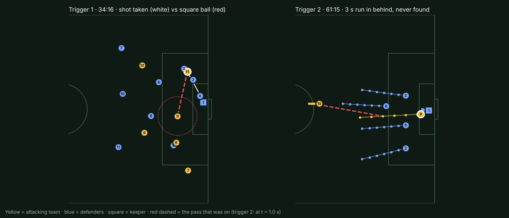
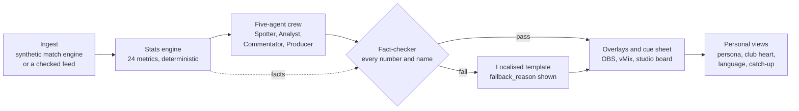

<h1 align="center">PitchPulse</h1>

<p align="center"><strong>The trust layer for match intelligence: explained, personalised, multilingual broadcast graphics where every number is checked against the stats engine.</strong></p>

<p align="center">
<a href="https://github.com/g-shankar/matchmind/actions/workflows/ci.yml"></a>
<a href="https://github.com/g-shankar/matchmind/actions/workflows/codeql.yml"></a>
<a href="LICENSE"></a>


</p>

PitchPulse turns a stream of synthetic football events into
explained, personalised, multilingual broadcast graphics, and shows its working
for every number on screen.

- **Deep football brain.** A deterministic stats engine (24 registered metrics,
  each with a formula and a quality flag) spots 14 kinds of moment, including
  "Should he have passed?": the open teammate, the passing lane and the chance
  the shooter gave up.
- **Trust layer.** Every number on air comes from the stats engine, never from
  a model. A fact-checker gates every sentence, each sentence is tied to its
  facts and source events, and "Show your working" opens the evidence.
- **Broadcast ready.** A versioned **cue sheet** drives the overlay, OBS and
  vMix, with VAR retractions; the same facts reach the casual fan and the
  analyst, in their own language.

**Live app:** <https://ca-pitchpulse.wonderfulbush-438b1d1e.swedencentral.azurecontainerapps.io/> (Azure Container Apps, Sweden Central; the crew runs on Azure OpenAI, with templates as the visible fallback).

Built by the PitchPulse team for the Microsoft x Premier League "Inside the
Game" hackathon. **Judges: [the brief, line by line](docs/HACKATHON-BRIEF.md)**
shows each requirement, where to see it, and where we fall short. All clubs,
players and matches are invented; no real teams, people, competitions or
broadcaster branding appear anywhere.



## Status at a glance

| Feature | State | Evidence |
|---|---|---|
| Stats engine, 24 metrics, 14 moment kinds | Live (offline, synthetic data) | [METRICS.md](docs/METRICS.md), `backend/tests/test_stats.py` |
| Fact-checker and claim audit | Live, tested | [TRUST.md](docs/TRUST.md), `backend/tests/test_trust.py` |
| Crew text (Analyst, Commentator, recap) | Template fallback: templates run today; model path built, off | [FOUNDRY.md](docs/FOUNDRY.md), `backend/tests/test_crew.py` |
| Cue sheet, VAR retraction, overlays | Live, tested | [CUE-SHEET.md](docs/CUE-SHEET.md), `backend/tests/test_cues.py` |
| Five studio languages | Live; not reviewed by native broadcasters | [LANGUAGES.md](docs/LANGUAGES.md) |
| Eight world languages (Translator) | Template fallback: shown in English and labelled; tested against fakes | `backend/tests/test_translator.py` |
| REST API contract | Live, drift-tested | [openapi.json](docs/openapi.json), `backend/tests/test_openapi_contract.py` |
| Azure deployment | Live on Azure Container Apps (Sweden Central), Azure OpenAI and Translator on; Bicep built in CI | [deployment/README.md](deployment/README.md) |
| Foundry agents wired to the API spec as a tool | Not built | [FOUNDRY.md](docs/FOUNDRY.md) |
| Real video input, neural voices | Not built | [Feature status](#feature-status) |

The full matrix is under [Feature status](#feature-status).

## Quick start

No cloud account and no keys. Pick one.

**Offline demo (Node 20 only, about a minute).** The browser plays a recorded
engine run of the demo match; no backend.

```bash
cd frontend && npm ci && npm run dev
# open http://localhost:3000/?demo=1
```

**Full app in one container (Docker).** API, WebSocket, MCP and the built
frontend on one port, crew in template mode.

```bash
docker build -f deployment/Dockerfile -t pitchpulse:local .
docker run --rm -p 8000:8000 -e MATCHMIND_PUBLIC_ORIGIN=http://localhost:8000 pitchpulse:local
# open http://localhost:8000/
```

**From source (Python 3.12+, Node 20).**

```bash
cd backend && pip install -e ".[dev]" && matchmind-api          # http://127.0.0.1:8000
cd frontend && npm ci && VITE_API_URL=http://127.0.0.1:8000 npm run dev   # http://localhost:3000
```

Without a reachable backend the frontend falls back to the offline demo and
says so in the header ("Offline demo"). `?demo=1` forces it; `?live=1` never
falls back.

## The 90-second golden path

Follow one moment from a seeded event to the screen. Links assume the dev
server on `localhost:3000` with the offline demo; drop `demo=1` when the
backend is running (the live server adds the crew trace, the cue-sheet feed
and typed Ask questions).

| # | What you see | Where |
|---|---|---|
| 1 | **Seeded event.** The demo script (`backend/src/matchmind/simulator/scripts/demo.yaml`) seeds a missed square ball: at 34:16 Kofi Asante shoots (event `MM-DEMO-001-00717`) while Adam Kerrigan is free. | [`/?demo=1&t=2050&p=1#studio`](http://localhost:3000/?demo=1&t=2050&p=1#studio) starts at 34:10 |
| 2 | **Metric with its formula.** The card says the pass was worth 4x the shot. The engine's facts: shot xG 0.05; pass 83% likely to arrive; Kerrigan's chance 0.24 xG; pass value 0.83 x 0.24 = 0.2; 0.2 / 0.05 = **4.0x**. The registry row gives the formula, thresholds and quality flag. | `#lab` (Under the hood) -> Metric registry; [docs/METRICS.md](docs/METRICS.md) |
| 3 | **Evidence-linked narrative.** **Show your working** on the card opens the claim audit: every sentence, every number bound to its fact key (`shot_xg`, `pass_success_pct`, `alt_xg`, `alt_value`, `times_better`) and source event. | Studio card -> "Show your working" |
| 4 | **Numeric check and fallback.** The drawer shows the fact-check result and what is *not* checked. A model sentence with a number outside the facts is never shown; the template is shown with a `fallback_reason`. Reproduce: `cd backend && pytest tests/test_crew.py -k unbacked_number_from_model`. | Audit drawer; Crew health panel (studio) |
| 5 | **Timed cue.** The same moment goes on air as a cue with a layer, start, duration and priority. At 39:11 Northbridge "score"; at 40:22 VAR rules it out: the goal's cues are **retracted**, the correction **supersedes** them and the scorebug goes back to 1-0. | `#overlay`; OBS/vMix source `?capture=1#overlay`; live: `GET /api/match/cue-sheet` |
| 6 | **Same facts, two audiences, another language.** Fan vs Analyst shows the casual and tactical telling side by side, plus the same moment in other languages; the numbers (0.05, 83%, 0.24, 4x) do not change. Switch to Español or العربية (right-to-left). Toggle "fan vs fan" for **club heart**: each club's fan gets their own framing, same numbers. | `#split` |
| +  | **Catch-up and questions.** Open with the result hidden, read the spoiler-free story so far, and ask the studio a question (or tap a chip): answers come from the engine as of the clock, fact-checked, with "how we know". | [`/?demo=1&catchup=1#studio`](http://localhost:3000/?demo=1&catchup=1#studio); "Ask the studio" box |

Views: `#studio` (Studio), `#overlay` (Broadcast), `#split` (Fan vs Analyst,
with the club-heart comparison), `#follow` (Player focus), `#fan` (My match),
`#lab` (Under the hood).

## The five-stage pipeline



| Stage | What happens | Where |
|---|---|---|
| 1. Ingest | A synthetic match engine plays 90 minutes on a 105 x 68 m pitch and streams typed events; or a feed you supply (JSONL, or CSV with a mapping) is checked strictly and played | `backend/src/matchmind/simulator`, `ingest/`; Azure Event Hubs (built, off) |
| 2. Interpret | A deterministic stats engine scores every event: xG, pass difficulty, pressure, expected threat, momentum, control vs chaos, the better option a shooter ignored, physical stats estimated from synthetic tracking | `backend/src/matchmind/stats`, [docs/METRICS.md](docs/METRICS.md) |
| 3. Explain | The studio crew (below) explains why the moment matters, with evidence rows, and fact-checks every sentence | `backend/src/matchmind/crew` |
| 4. Render | Studio board, broadcast overlay, cue sheet for graphics systems, a replay that draws the missed pass on the pitch | `frontend/`, [docs/CUE-SHEET.md](docs/CUE-SHEET.md) |
| 5. Personalise | Four personas, a favourite club (club heart), a focus player, a focus metric, catch-up mode, 13 languages | `crew/producer.py`, `crew/club_heart.py`, [docs/PERSONALISATION.md](docs/PERSONALISATION.md) |

## The studio crew

Five agents, plus the recap step and the translator step. **Spotter,
Fact-checker and Producer are deterministic by design**: numbers come from the
stats engine, and the checker must sit in the same process as the text it
gates. The model-backed steps run as templates unless the owner switches paid
AI on.

| Step | Job | How it runs | Hands off |
|---|---|---|---|
| Spotter | Finds moments in the event stream (14 kinds) and attaches the only numbers anyone may use | Deterministic rules | `Moment` |
| Analyst | Explains why the moment matters, with evidence rows | Template; model-backed when AI is on | `Explanation` |
| Fact-checker | Rejects any number or name not backed by the moment's facts, on every text and after translation | Deterministic | `FactCheck` |
| Commentator | Voices it for one audience in one language | Template; model-backed when AI is on | `Narrative` |
| Producer | Picks the overlay slot, timing and priority for each viewer; feeds the cue sheet | Deterministic | `OverlayCard`, cues |
| Recap (Producer step) | Full-time recap per audience; spoiler-free "story so far" in catch-up | Template; model-backed at full time when AI is on (the story is always templates) | `Recap` |
| Translator | English card into 8 world languages, numbers and names protected | Azure AI Translator (machine translation) when switched on; else shown in English and labelled | translated `OverlayCard` |

Moment kinds (`MomentKind` in `crew/contracts.py`): goal, card, big chance,
better option ("Should he have passed?"), unfound run, momentum swing,
pressure spell, speed burst, rocket shot, distance milestone, hard pass, key
tackle, milestone (kick-off, half-time, full-time, player milestones),
correction (VAR).

Each model step has a timeout, one repair retry on a schema mismatch, a
circuit breaker and a process-wide budget; any failure falls back to the
localised template and says so on the card (`fallback_reason`). The crew can be
chained in-process (default) or by Microsoft Agent Framework with identical
output (tested). Details: [docs/FOUNDRY.md](docs/FOUNDRY.md).

## What PitchPulse is not

- **Not betting advice.** Nothing here predicts results or suggests a stake.
- **Not a replacement for officials.** VAR reviews in the demo are simulated
  events; PitchPulse explains moments, it does not rule on them.
- **A score is not proof of the right decision.** "Should he have passed?" compares
  two modelled chances at one instant; see [DECISION-SCORING.md](docs/DECISION-SCORING.md)
  (method v1) for the formula and its limits.
- **Not real football.** Synthetic data only: invented clubs, players and matches.

## Feature status

One matrix for everything. Labels:

- **Running**: works in this repository today, offline, no cloud account.
- **Simulated (synthetic)**: running, on synthetic data by design; not real
  footage or real tracking.
- **Built, off until deployed**: code, tests and infrastructure are done,
  tested against fakes; switches on with the owner's Azure subscription.
- **Planned**: not built.
- **Future enterprise extension**: built and tested, not needed for the
  hackathon brief and not in the demo; the core pipeline runs without it.

| Feature | Status | Evidence / doc |
|---|---|---|
| Synthetic match engine, 5 bundled matches, seeded generator | Simulated (synthetic) | CI regenerates the dataset byte for byte; [DATASET.md](docs/DATASET.md) |
| Stats engine and metric registry (24 metrics, 5 listed as not computed) | Running | `GET /api/metrics`; [METRICS.md](docs/METRICS.md) (generated, test-checked) |
| Physical stats (distance, speed bands, sprints, top speed) | Simulated (synthetic): estimated from synthetic tracking | `stats/physical.py`, `tests/test_physical.py` |
| Studio crew in template mode, 14 moment kinds | Running | `tests/test_crew.py` |
| Trust layer: per-sentence claims, cross-persona and cross-language parity, moment audit, "Show your working" | Running | `GET /api/match/moment/{id}/audit`; [TRUST.md](docs/TRUST.md) |
| Cue sheet v1.0 (REST, WebSocket `CUES`, JSON Schema) | Running | [CUE-SHEET.md](docs/CUE-SHEET.md), `tests/test_cues.py` |
| VAR retraction (retract, supersede, corrected scorebug) | Running (VAR reviews are simulated events) | `tests/test_corrections.py` |
| Personas: Fan, Analyst, Stats scout, Player cam | Running | [PERSONALISATION.md](docs/PERSONALISATION.md) |
| Club heart (fan's-side selection and framing, same numbers) | Running on the live backend; the offline demo changes only priority and the club label | `tests/test_club_heart.py` |
| 5 studio languages (English, Español, Français, العربية right-to-left, 日本語) | Running; written by the team, **not yet reviewed by native-speaking broadcasters** | [LANGUAGES.md](docs/LANGUAGES.md) |
| 8 world languages (Português, Deutsch, हिन्दी, 简体中文, Kiswahili, Bahasa Indonesia, Türkçe, 한국어) via Azure AI Translator, fact-checked again | Built, off until deployed (shown in English and labelled) | `tests/test_translator.py` |
| Spoiler-safe catch-up (`?catchup=1`, story so far) | Running | `tests/test_spoilers.py` |
| Ask the studio (guard, rule parser, templates, fact-check) | Running (typed questions need the live server; chips work offline) | [ASK.md](docs/ASK.md), `tests/test_ask.py` |
| Ask model intent (fixed-schema intent only) | Built, off until deployed | `tests/test_ask.py` |
| Read-aloud (on-device browser voices only, nothing sent to a server) | Running, off by default | `frontend/src/lib/speech.ts` |
| Neural voices (Azure AI Speech) | Planned | |
| Auto-eventing: a tracking-feed detector (25 Hz positions to passes, shots, tackles, kick speed), benchmark on held-out seeds | Simulated (synthetic): detected from synthetic tracking, not video | [AUTO-EVENTING.md](docs/AUTO-EVENTING.md) |
| Pixel path (rendered top-down frames, classical vision) | Simulated (synthetic): rendered synthetic video, not broadcast footage | [AUTO-EVENTING-BENCHMARK.md](docs/AUTO-EVENTING-BENCHMARK.md) |
| Real video input | Planned | |
| Dataset export (API, CLI: JSONL, CSV, tracking window) | Running | `GET /api/dataset`; [DATA-DICTIONARY.md](docs/DATA-DICTIONARY.md) |
| Feed ingest (JSONL or CSV + mapping + roster) | Running | `matchmind-ingest`, `tests/test_ingest.py` |
| Event Hubs publisher (simulator job) | Built, off until deployed | `simulator/publisher.py` |
| Event Hubs consumer (live source) | Built, off until deployed; tested against a fake consumer | `tests/test_live_source.py` |
| Lakehouse export (Parquet star schema, decision labels) | Future enterprise extension (runs locally) | [ANALYTICS.md](docs/ANALYTICS.md) |
| Fabric notebook and Eventhouse KQL | Future enterprise extension: not run in Fabric yet | `analytics/fabric/` |
| Live enriched stream to a second event hub | Planned | |
| MCP server, 15 read-only tools, byte parity with REST | Future enterprise extension (runs locally) | [MCP.md](docs/MCP.md), `tests/test_mcp.py` |
| MCP `export_dataset` and `audit_claims` tools | Planned (the data is on REST today) | |
| Azure OpenAI `gpt-4o-mini` for Analyst, Commentator and recap | Built, off until deployed | `tests/test_crew.py` (fake model) |
| Microsoft Foundry Agent Service (3 agents from the cards) | Built, off until deployed; not run against a live project | `tests/test_foundry_agent_service.py` |
| Microsoft Agent Framework orchestration | Future enterprise extension, off by default (free and local with the `agent-framework` extra) | `tests/test_agent_framework.py` (identical cards) |
| Agent cards for all five agents, generated from code | Running | `foundry/agents/*.yaml` |
| Local evaluation (6,780 records, five evaluators) | Future enterprise extension (runs locally) | [EVALUATION.md](docs/EVALUATION.md) |
| Foundry cloud evaluators (Groundedness, Relevance) | Built, off until deployed: documented, not run | [EVALUATION.md](docs/EVALUATION.md) |
| Crew tracing (OpenTelemetry, GenAI conventions, no text or viewer data) | Running as a no-op locally; Application Insights export built, off until deployed | `tests/test_telemetry.py` |
| Crew health panel, Under the hood lab | Running | `#studio`, `#lab` |
| OBS / vMix capture (`?capture=1#overlay`) | Running | [OBS.md](docs/OBS.md) |
| Security: origin allow-lists, rate limits, size caps, CSP, HSTS, `no-store` | Running | [THREAT-MODEL.md](docs/THREAT-MODEL.md) |
| Azure deployment (Container Apps, Bicep, OIDC, managed identities, no keys) | Built, off until deployed | [deployment/README.md](deployment/README.md) |

## Microsoft technologies

Checked against `deployment/azure_bicep/main.bicep` and the code. None is
deployed yet; the default build runs offline with no cloud account.

| Technology | Used for | Status |
|---|---|---|
| Azure Container Apps | The app and the simulator job | Built, off until deployed |
| Azure Event Hubs | Match event stream (keyless) | Built, off until deployed |
| Microsoft Foundry (resource, project, `gpt-4o-mini` deployment) | Analyst, Commentator, recap | Built, off until deployed |
| Foundry Agent Service | The three model steps as registered agents | Built, off; not run against a live project |
| Azure AI Translator | Eight world languages | Built, off until deployed |
| Application Insights and OpenTelemetry | Crew traces (no text or viewer data) | Tracing code runs as a no-op; export built, off |
| Microsoft Entra ID, managed identities | Keyless sign-in to every Azure call | Built in Bicep, off until deployed |
| Azure Container Registry, Log Analytics, Bicep | Image, logs, infrastructure as code | Built; `bicep build` runs in CI |
| Microsoft Agent Framework | Optional crew orchestration, identical cards (tested) | Off by default (local extra) |
| Microsoft Fabric (Lakehouse, Eventhouse) | Export files and KQL | Files and queries only; not run in Fabric |
| GitHub Actions, CodeQL | CI, scanning, OIDC deploy workflow | Running (deploy needs the owner's subscription) |

Feature-by-feature mapping: [Microsoft services, feature by feature](#microsoft-services-feature-by-feature).

## Microsoft services, feature by feature

| Judging area | PitchPulse feature | Microsoft service | Status |
|---|---|---|---|
| Analyze match events in real time | Simulator streams each event, partitioned by match; the app can follow the live stream | Azure Event Hubs (keyless, local auth off) | Built, off until deployed |
| | Stats engine and crew react to each event over a WebSocket | Azure Container Apps | Running locally; Container Apps built, off until deployed |
| | Live xG race, pressure by five-minute window, sprint leaders | Microsoft Fabric Real-Time Intelligence (Eventhouse, KQL) | Future enterprise extension (not run in Fabric yet) |
| Generate stories, highlights and recaps | Commentator voices each moment; a full-time recap per audience and language | Azure OpenAI `gpt-4o-mini` on a Microsoft Foundry resource | Built, off until deployed (templates run today) |
| Explain key moments and tactical patterns | Analyst explains why a moment matters with evidence rows; "Should he have passed?" is detected, measured and drawn | Stats engine; Microsoft Foundry for the model path | Running (templates); model path built, off |
| Expand datasets for AI and analytics | New seeded matches; star schema and labelled decision set | Microsoft Fabric Lakehouse (Parquet to Delta) | Future enterprise extension: export runs locally; Fabric load not run |
| | 6,780-record evaluation set in Azure AI Evaluation format, scored locally | Microsoft Foundry evaluations | Future enterprise extension: runs locally; cloud evaluators not run |
| Insights for fans around the world | Five studio languages | | Running |
| | Eight world languages, numbers and names protected, fact-checked after translation | Azure AI Translator (keyless) | Built, off until deployed |
| Personalised experiences | Overlay, studio board, Fan vs Analyst, club heart, player focus, My match, catch-up, Ask the studio | Azure Container Apps | Running locally |
| Trustworthy AI | Agent traces with GenAI semantic conventions, no text or viewer data | Application Insights, Foundry tracing | Built, off until deployed |
| | Agent cards for all five agents, generated from the code | Microsoft Foundry | Running (`foundry/agents/`) |
| | Analyst, Commentator and recap as Foundry agents, registered idempotently (`matchmind-foundry register`) | Microsoft Foundry Agent Service | Built, off until deployed |
| | The crew's chains as typed workflows, identical cards to the in-process crew | Microsoft Agent Framework | Future enterprise extension, off by default |
| | Match intelligence as read-only MCP tools | Model Context Protocol (any MCP client) | Future enterprise extension (runs locally) |
| Engineering | CI with tests, secret scanning, licence check, Bicep lint, container smoke test; CodeQL; Dependabot; code review on every PR | GitHub Actions, GitHub code scanning | Running |
| | One-click deploy with what-if, OIDC sign-in, no stored secrets | GitHub Actions, Azure Bicep, Microsoft Entra ID | Built, needs the owner's subscription |

No service key exists anywhere: every Azure call signs in with Microsoft Entra
ID through managed identities, and key-based login is switched off on the
resources themselves.

## Measured numbers

All measured on 22 Oct 2026 in template mode, offline, on the five bundled
synthetic matches unless stated.

| Measure | Result | Source |
|---|---|---|
| **North star: on-air sentences that print a number, with every number machine-verified against the stats engine** | **17,889 of 17,889** (0 failed, 0 cards withheld) | [TRUST.md](docs/TRUST.md) |
| All sentences bound to a fact (number or squad name) | 23,631 of 25,713 (91.9%); the other 2,082 carry no number or name to check | [TRUST.md](docs/TRUST.md) |
| Numbers grounded in facts | 6,780 of 6,780 records | [EVALUATION.md](docs/EVALUATION.md) |
| Strict grounding (number words too) | 6,622 of 6,780 (97.7%); the 158 are template idioms such as "passe la cinquième" | [EVALUATION.md](docs/EVALUATION.md) |
| Length limits | 6,780 of 6,780 | [EVALUATION.md](docs/EVALUATION.md) |
| Persona vocabulary | 6,720 of 6,780 (99.1%); one known gap (tactical booking card has no numbers) | [EVALUATION.md](docs/EVALUATION.md) |
| Language detection | 6,780 of 6,780 | [EVALUATION.md](docs/EVALUATION.md) |
| Same key facts across 4 personas x 5 studio languages | 334 of 334 moments | [TRUST.md](docs/TRUST.md) |
| Auto-eventing, held-out (10 matches, 1.46 M frames): pass F1, shot F1, tackle F1 | 0.996, 0.935, 0.922; kick-speed error 1.08 km/h | [AUTO-EVENTING-BENCHMARK.md](docs/AUTO-EVENTING-BENCHMARK.md) (circular by construction: synthetic tracking) |
| Ask the studio | 50 of 50 table questions in en, es, fr, ar answered with the right intent; 37 of 37 adversarial inputs refused | `tests/test_ask.py` |
| Tests | Backend 1,193 passed (12 skipped, optional extras); frontend 317 passed | `pytest -q`, `npm test` |

The model path (paid AI on) has not been evaluated on live output; that needs
the owner's approval to spend.

## What is honest about this

- **Synthetic data only.** Two invented clubs, invented players, simulated
  matches. Nothing here is real football data.
- **Tracking, not video.** Auto-eventing is a tracking-feed detector: it reads
  player and ball positions at 25 Hz, the feed an optical tracking system
  produces from stadium cameras, here synthetic. The pixel path runs first on
  rendered synthetic top-down video. There is no real-video model, and the
  benchmark is circular by construction.
- **Templates, not reviewed by native broadcasters.** The five studio packs were
  written by the team; native-speaker review is planned before any launch.
  World languages are machine translation and are off by default.
- **AI off by default, on purpose.** Template mode is the hallucination guard:
  every card you see today is a fact-checked template, and when the model is
  on, any card it gets wrong falls back to the template. The model path is
  built and tested against fakes; one setting, `MATCHMIND_AI_ENABLED=true`,
  turns it on once the owner approves the spend.
- **The checker is narrow.** It verifies numbers and squad names, units,
  per-club attribution and simple comparisons. It does not verify tone, causal
  wording or negation ([TRUST.md](docs/TRUST.md#what-is-not-checked)).
- **Not deployed yet.** Every Azure piece is in the Bicep template and CI; none
  runs in a subscription yet.

## Other tools

```bash
cd backend
matchmind-sim dataset --out data/matches            # regenerate the bundled matches
matchmind-lakehouse export --seeds 20 --with-labels # Fabric-ready tables plus 20 new matches
matchmind-foundry eval-dataset && matchmind-foundry eval   # evaluation set and scorecard
matchmind-autoevent benchmark                       # auto-eventing benchmark report
matchmind-ingest validate data/examples/feed.csv --mapping data/examples/mapping.yaml --roster data/examples/roster.yaml
matchmind-mcp --clock-s 4200 --period 2             # the MCP tools over stdio
```

Checks: `make check` runs what CI runs.

## Deploy to Azure

`deployment/azure_bicep/main.bicep` creates one resource group: Container Apps
(app and simulator job), Event Hubs, a Microsoft Foundry resource and project,
Azure AI Translator, Application Insights, Container Registry and Log
Analytics, with two managed identities holding only the roles they need. Paid
AI is off by default; `MATCHMIND_AI_ENABLED=true` is the one switch for the
live crew. One command from Azure Cloud Shell, preview first:

```bash
deployment/deploy.sh            # what-if: shows what would be created, creates nothing
deployment/deploy.sh --apply    # deploy and print the preview URL
```

The GitHub Actions **deploy** workflow does the same with OIDC sign-in. See
[deployment/README.md](deployment/README.md) and
[setup/owner-todo.md](setup/owner-todo.md).

## Repository map

| Path | What |
|---|---|
| `backend/src/matchmind/schema` | Event models and JSON Schema |
| `backend/src/matchmind/simulator` | Synthetic match engine, invented clubs and players, Event Hubs publisher |
| `backend/src/matchmind/ingest` | Feed validation, CSV adapter, Event Hubs consumer |
| `backend/src/matchmind/stats` | Deterministic metrics, chance model, better option, physical stats, metric registry |
| `backend/src/matchmind/crew` | The crew, fact-checker, claims, audit, club heart, spoilers, cue sheet, language packs, model and Translator clients, tracing |
| `backend/src/matchmind/ask` | Ask the studio: guard, parser, answers |
| `backend/src/matchmind/api` | FastAPI REST and WebSocket session |
| `backend/src/matchmind/mcp` | MCP server and tools |
| `backend/src/matchmind/autoevent` | Events detected from synthetic tracking, pixel path, benchmark |
| `backend/src/matchmind/dataset` | Dataset catalogue, export, data dictionary |
| `backend/src/matchmind/analytics` | Lakehouse export and decision dataset |
| `backend/src/matchmind/foundry` | Agent cards, evaluation, Foundry Agent Service runtime and registration |
| `frontend/` | React broadcast, studio and fan app; offline demo in `public/demo/` |
| `analytics/fabric/` | Lakehouse notebook and Eventhouse KQL |
| `foundry/agents/` | Generated agent cards |
| `deployment/` | Bicep, Dockerfile, deploy notes |
| `docs/` | Everything below, including the committed API contract `docs/openapi.json` |
| `backend/tests/` | Backend test suite |
| `.github/workflows/` | CI, CodeQL, deploy |
| `setup/` | Owner to-do list |

## Docs

| Doc | What |
|---|---|
| [HACKATHON-BRIEF.md](docs/HACKATHON-BRIEF.md) | The hackathon brief line by line, gaps, future enterprise extensions |
| [ARCHITECTURE.md](docs/ARCHITECTURE.md) | System map with Live / Built-off / Planned labels, trust boundaries, data flows |
| [adr/](docs/adr/README.md) | Architecture decision records |
| [THREAT-MODEL.md](docs/THREAT-MODEL.md) | Assets, threats and mitigations per surface, with the tests that enforce them |
| [BUILD-STATUS.md](docs/BUILD-STATUS.md) | Current status, evidence commands, known issues |
| [NEXT-STEPS.md](docs/NEXT-STEPS.md) | The remaining roadmap: what is left and who does it |
| [API-CONTRACT.md](docs/API-CONTRACT.md) | REST, WebSocket and MCP payloads, server settings |
| [openapi.json](docs/openapi.json) | Generated OpenAPI 3 spec (`make openapi`; a test fails on drift) |
| [DECISION-SCORING.md](docs/DECISION-SCORING.md) | "Should he have passed?": inputs, formula (v1), thresholds, limits |
| [REALISM.md](docs/REALISM.md) | Realism checks on the synthetic matches |
| [benchmark/](docs/benchmark) | Benchmark outputs |
| [images/](docs/images) | Screenshots used in the docs |
| [METRICS.md](docs/METRICS.md) | Every metric's formula, generated from the registry |
| [TRUST.md](docs/TRUST.md) | What the trust layer checks and does not check; claims, parity, audit |
| [EVALUATION.md](docs/EVALUATION.md) | Evaluation dataset and scorecard |
| [CUE-SHEET.md](docs/CUE-SHEET.md) | The cue sheet output contract |
| [OBS.md](docs/OBS.md) | Graphics in OBS Studio and vMix |
| [PERSONALISATION.md](docs/PERSONALISATION.md) | Personas, club heart, focus, catch-up |
| [LANGUAGES.md](docs/LANGUAGES.md) | Studio packs, glossary, Azure AI Translator |
| [ASK.md](docs/ASK.md) | Ask the studio and read-aloud |
| [MCP.md](docs/MCP.md) | MCP tools and how to attach a client |
| [FOUNDRY.md](docs/FOUNDRY.md) | Microsoft Foundry, Agent Service, Agent Framework, tracing |
| [AUTO-EVENTING.md](docs/AUTO-EVENTING.md) | Tracking-to-event detection and its limits |
| [AUTO-EVENTING-BENCHMARK.md](docs/AUTO-EVENTING-BENCHMARK.md) | Generated benchmark report |
| [DATASET.md](docs/DATASET.md) | The synthetic dataset, ingest and the live source |
| [DATA-DICTIONARY.md](docs/DATA-DICTIONARY.md) | Every field, generated from the schema |
| [ANALYTICS.md](docs/ANALYTICS.md) | Lakehouse export and Eventhouse queries |
| [deployment/README.md](deployment/README.md) | Deploying to Azure |
| [PROJECT_PLAN.md](PROJECT_PLAN.md) | Architecture and roadmap in one page |

## How we work

One feature per pull request. Every pull request runs the full test suite,
secret scanning, CodeQL, the licence check and a container smoke test, gets
an automated code review, and gets an independent security review before
merge. Every dependency allows
commercial use.

## Licence

MIT.
