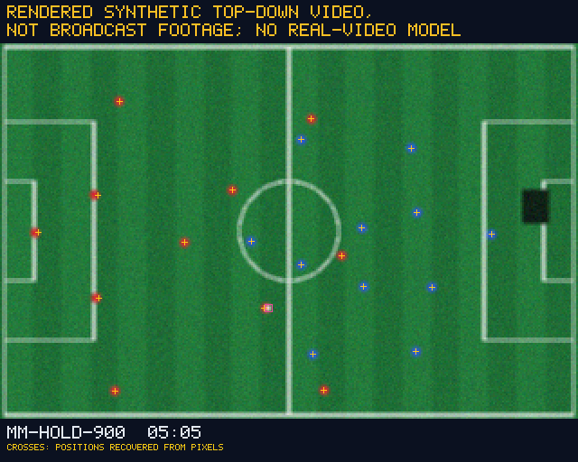
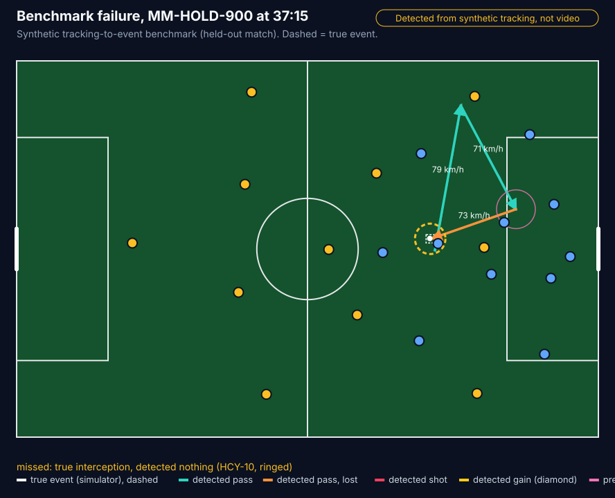
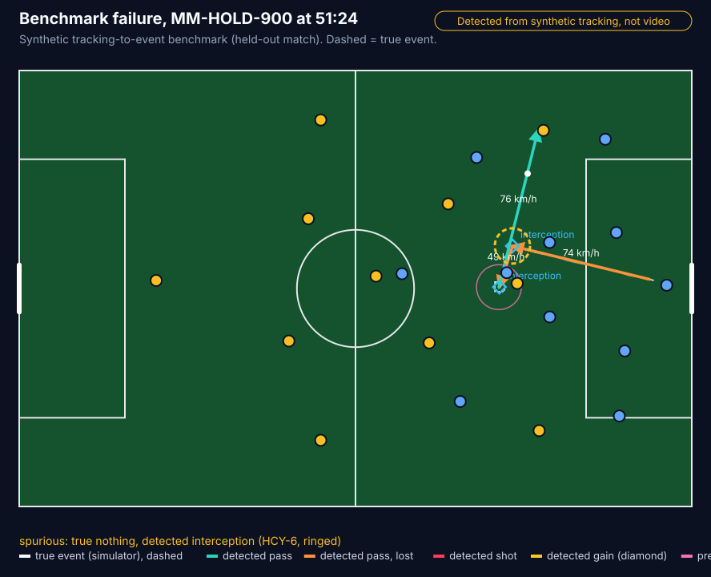
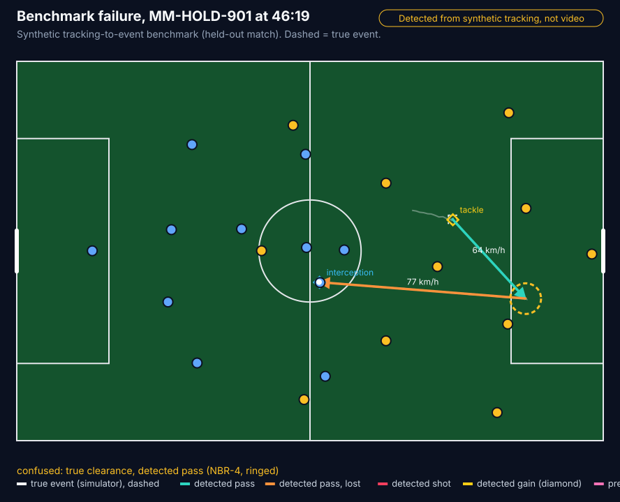
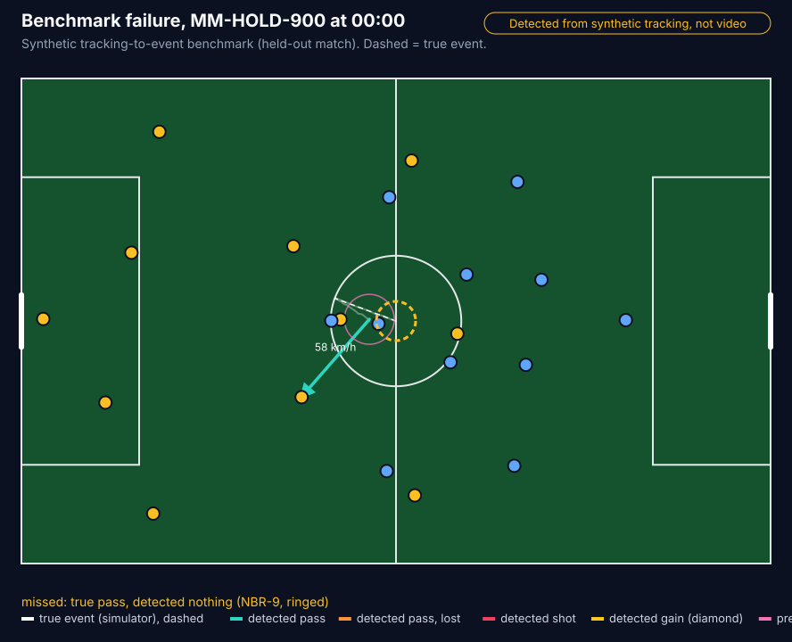
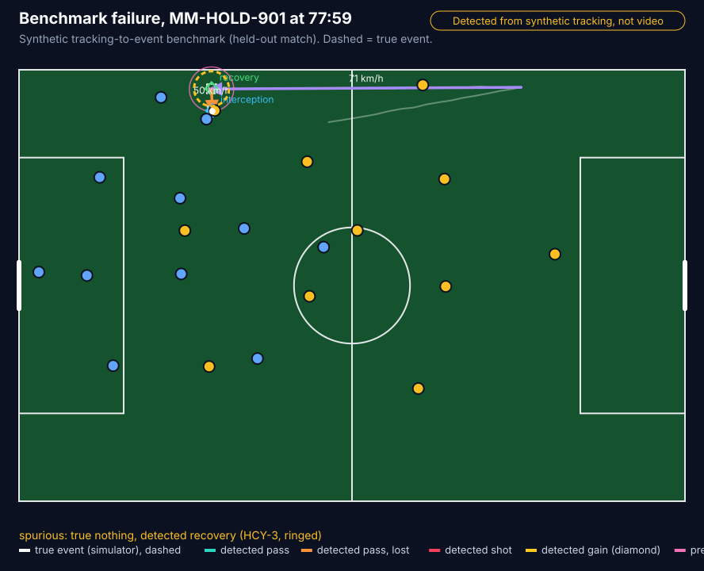
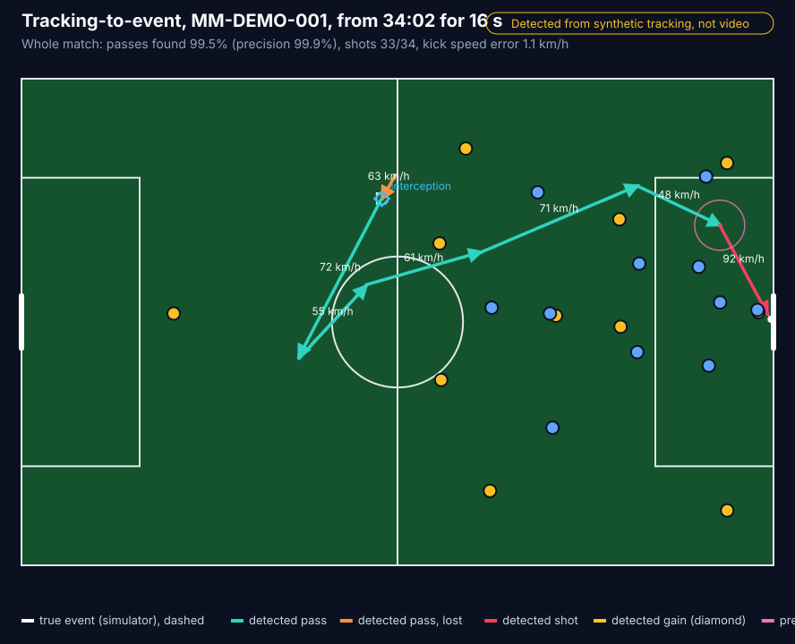

# Synthetic tracking-to-event benchmark

> **Detected from synthetic tracking, not video.** The pixel path below is
> **rendered synthetic top-down video, not broadcast footage; there is no
> real-video model** anywhere in PitchPulse.

**Read this first: the benchmark is circular by construction.** The tracking
feed is rendered from the same simulated events that we then use as ground
truth. The detector and the truth therefore share the simulator's assumptions:
the ball flies in straight lines at the recorded speed with no height, the ball
holder stands 0.35 m behind the ball, a receiver arrives where the pass ends,
and an opponent the event data lists as pressing is drawn 2.2 m from the ball.
The numbers below measure how well the detection and classification rules
recover events from clean, cooperative synthetic data. They say nothing about
real tracking data or real footage, and they should be read as an upper bound
for this method.

Code: `backend/src/matchmind/autoevent/`. Tests:
`backend/tests/test_autoevent.py`, `backend/tests/test_autoevent_benchmark.py`.
Full generated report: [AUTO-EVENTING-BENCHMARK.md](AUTO-EVENTING-BENCHMARK.md)
(and the same run as JSON in `docs/benchmark/auto-eventing-benchmark.json`).

## What it does

1. **Render a tracking feed** (`tracking.py`). The ball and all 22 players at
   25 frames a second, from a simulated match: the ball follows the events at
   their recorded speeds, the holder stands with it, everyone else holds a
   team shape and runs to where the events need them next (receiving,
   intercepting, pressing). 5 cm of position noise, short ball dropouts and a
   ball-in-play flag on every frame.
2. **Detect events from frames only** (`detect.py`). The detector never sees
   the events. It finds who controls the ball in each frame, then:
   - **kicks**: pass (complete, incomplete, out), shot (goal, saved, blocked,
     off target) and clearance, with the kick speed fitted from the first
     0.24 s of flight;
   - **possession changes**: a *tackle* when control passes to the other team
     with no kick in between, an *interception* when the other team takes a
     pass in flight, a *recovery* when anyone takes a loose ball (after a
     clearance, a blocked shot or a kick that came to rest);
   - **pressure**: at each kick, an opponent within 3.5 m of the ball for at
     least 0.2 s up to the kick (3.5 m is the radius the event data uses for
     its own `under_pressure` flag).
   Before any of that it estimates the feed's noise from the ball track and,
   only if it is above 8 cm, smooths positions over a short window; it also
   bridges gaps of up to 2 s in a player's track. The rules and every
   threshold are written out at the top of `detect.py`.
3. **Pixel path** (`pixels.py`). Each tracking frame is drawn as a 320 x 208
   px top-down image (3 px per metre, team-coloured discs, a white ball,
   pitch stripes and lines, pixel noise, a 3 x 3 blur, and dark patches that
   hide whatever is under them for about a second). A frames-only vision
   step then recovers positions from the pixels: background model, colour
   classification, connected components, splitting merged blobs, and
   nearest-neighbour tracking. The **same detector** runs on the recovered
   positions. numpy only, no trained model. Player identities are tagged once
   at the start of the clip (as an operator would at kick-off) and only
   tracked after that; the ball-in-play flag is passed through, not recovered.
4. **Score** (`score.py`, `benchmark.py`). The simulator's events are the
   truth. A detection matches a true event when it is the same player, in the
   same period, within 0.5 s, one to one (same-kind pairs first).



A 10 s clip of the pixel path (held-out match MM-HOLD-900 from 05:00, 70 KB):
[images/pixel-path.mp4](images/pixel-path.mp4). The label is burnt into
every frame.

## How it is evaluated

- **Split.** Every threshold in `detect.py` was set while looking only at the
  *tuning split*: the five published matches in `backend/data/matches`
  (seeds 100-104). The *held-out split* is ten new matches, seeds 900-909
  (`MM-HOLD-900` to `MM-HOLD-909`), which were never used to set a threshold.
  The held-out numbers are the headline.
- **Per class** precision, recall and F1, with the support (number of true
  events) and a **95% Wilson interval** for precision and recall.
- **Confusion matrix** over the six event kinds, with a *missed* column (a
  true event nothing matched) and a *spurious* row (a detection nothing
  matched). Row totals equal the true counts and column totals the detected
  counts; a test checks this.
- **Kick-speed error**: mean absolute error over matched passes and shots,
  with a **95% percentile bootstrap interval** (1000 resamples, fixed seed).
- **Naive baseline**, scored the same way: every ball-speed spike is a pass by
  the nearest player, every change in the team of the nearest player is a
  tackle, and a spike is under pressure if an opponent is within 3.5 m.
- **Robustness sweep** on three held-out matches: position noise 5, 15 and
  30 cm, ball dropouts 0.5 per second, player occlusion 0.1 and 0.3 per second
  per player, and all of it at once.
- **Pixel path vs coordinate path** on the same frames: the first 180 s of
  three held-out matches.

## Results (held-out, 10 matches, 1.46 million frames)

| Class | Support | Detected | Matched | Precision (95% CI) | Recall (95% CI) | F1 |
|---|---:|---:|---:|---|---|---:|
| pass | 13210 | 13165 | 13141 | 99.8% (99.7-99.9%) | 99.5% (99.3-99.6%) | 0.997 |
| shot | 252 | 255 | 237 | 92.9% (89.1-95.5%) | 94.0% (90.4-96.4%) | 0.935 |
| clearance | 93 | 93 | 91 | 97.9% (92.5-99.4%) | 97.9% (92.5-99.4%) | 0.979 |
| tackle | 649 | 630 | 593 | 94.1% (92.0-95.7%) | 91.4% (89.0-93.3%) | 0.927 |
| interception | 2226 | 2212 | 2185 | 98.8% (98.2-99.2%) | 98.2% (97.5-98.6%) | 0.985 |
| recovery | 103 | 109 | 78 | 71.6% (62.5-79.2%) | 75.7% (66.6-83.0%) | 0.736 |
| pressure | 2285 | 3165 | 2174 | 68.7% (67.0-70.3%) | 95.1% (94.2-96.0%) | 0.798 |

Kick-speed error **1.08 km/h** (95% CI 1.02-1.15, n = 13,378 kicks). Right
receiver on matched complete passes: 99.4%. The tuning split gives similar
numbers (see the full report); shots and recoveries have small supports, and
their intervals are wide.

Confusion matrix (rows: truth or *spurious*; columns: detection or *missed*):

| true \ detected | pass | shot | clearance | tackle | interception | recovery | missed |
|---|---:|---:|---:|---:|---:|---:|---:|
| **pass** | 13141 | 18 | 2 | 0 | 0 | 0 | 49 |
| **shot** | 8 | 237 | 0 | 0 | 0 | 0 | 7 |
| **clearance** | 2 | 0 | 91 | 0 | 0 | 0 | 0 |
| **tackle** | 0 | 0 | 0 | 593 | 4 | 1 | 51 |
| **interception** | 0 | 0 | 0 | 0 | 2185 | 10 | 31 |
| **recovery** | 0 | 0 | 0 | 1 | 0 | 78 | 24 |
| **spurious** | 14 | 0 | 0 | 36 | 23 | 20 | 0 |

**Against the naive baseline** (same held-out matches): pass F1 0.792
(precision 67.1%), tackle F1 0.136 (precision 7.3%), pressure F1 0.619. The
detector's control and kick rules are what remove the baseline's false
positives; its recall is similar.

**Robustness** (F1 on three held-out matches; full table in the report):

| Setting | pass | shot | tackle | interception | recovery | pressure | kick-speed error |
|---|---:|---:|---:|---:|---:|---:|---:|
| base feed (5 cm) | 0.997 | 0.925 | 0.940 | 0.983 | 0.733 | 0.808 | 1.08 km/h |
| 15 cm noise | 0.973 | 0.831 | 0.879 | 0.950 | 0.724 | 0.785 | 3.80 km/h |
| 30 cm noise | 0.967 | 0.618 | 0.773 | 0.920 | 0.786 | 0.771 | 8.69 km/h |
| ball dropouts 0.5/s | 0.989 | 0.889 | 0.910 | 0.956 | 0.746 | 0.806 | 2.45 km/h |
| player occlusion 0.3/s | 0.989 | 0.925 | 0.901 | 0.966 | 0.557 | 0.792 | 1.09 km/h |
| all of it at once | 0.953 | 0.525 | 0.752 | 0.902 | 0.567 | 0.747 | 9.96 km/h |

Passes and interceptions degrade gently. Shots, clearances and recoveries
degrade fastest (shots rely on the fitted kick speed and direction;
clearances and recoveries rely on telling a loose ball from a held one), and
the kick-speed error grows with the noise because the speed is still fitted
on the raw ball.

**Pixel path** (rendered synthetic top-down video, not broadcast footage; no
real-video model). First 180 s of MM-HOLD-900, -901 and -902, 13,500 frames,
about 30 s of compute per match window. Recovered player positions: median
error 0.02 m, 95th percentile 0.36 m; ball median error 0.05 m, recovered in
99.6% of frames where it was tracked.

| Class (same frames) | Support | Coordinate path F1 | Pixel path F1 |
|---|---:|---:|---:|
| pass | 127 | 0.988 | 0.968 |
| interception | 18 | 1.000 | 0.757 |
| tackle | 4 | 1.000 | 0.889 |
| shot | 2 | 1.000 | 0.667 |
| pressure | 21 | 0.760 | 0.735 |

The pixel path also makes 4 spurious clearances and 3 spurious recoveries in
that window, and its kick-speed error is 1.40 km/h against 1.16 km/h. The
sample is small (three minutes from each of three matches); intervals are in
the report. Looking at each event the pixel path lost: the interceptions are
mostly found, but 0.5 to 1.3 s late, outside the matching window; and some
received passes look loose and are read as clearances. Both happen around
contested moments, where discs overlap each other and the ball and the
recovered positions are off by up to about 1 m for a few frames. Identity
swaps are rare in these windows (two to four players, briefly, per window).

## Failure examples (held-out)

Drawn by `render_failure_svg` (dashed = true event, coloured = detected,
yellow ring = the event in question).

1. **Missed interception** (MM-HOLD-900, 22:48). The interceptor loses the
   ball in a failed dribble 0.6 s later. His spell on the ball is shorter
   than the 0.3 s the detector needs to call a change of possession, so
   neither the interception nor the tackle that follows is found.
   
2. **Spurious interception** (MM-HOLD-900, 25:26). An opponent standing next
   to the receiver is briefly the nearest player when a 22 m/s pass arrives,
   so the detector calls an interception, a short pass and a second
   interception where the event data has one complete pass.
   
3. **Clearance read as a pass** (MM-HOLD-901, 46:19). A 37 m clearance is
   reached by an opponent before it settles, so it is not loose for 0.4 s and
   looks like a misplaced pass; the event data records a clearance and a
   recovery 4.4 s later.
   
4. **Missed kick-off pass** (MM-HOLD-900, 00:00). The feed starts each half
   with the players in their team shape and the kick-off in the very first
   frame, so the kicker is not yet near the ball and nobody controls it before
   the kick. This is a feed artefact more than a detector rule: kick-offs
   after goals are found, the two that start the halves are not (6 of 16
   kick-off passes missed in three tuning matches).
   
5. **Spurious recovery** (MM-HOLD-900, 08:40). A fast cut-back into the box is
   called a blocked shot, so the teammate's first touch is called a recovery.
   With no ball height, a hard low pass towards goal and a shot look alike.
   

## Honest limits

- **Circular** (see the top). Pressure is the clearest case: pressers are
  drawn where the event data says they were, so high pressure recall is
  partly by construction. Its precision (69%) is low because the team-shape
  model also brings opponents within 3.5 m when the event data says no one
  was pressing.
- **Synthetic only.** No ball height, spin or bounce; simple player motion; no
  keeper role in the feed (a held save can be called blocked).
- **Not video.** The pixel path draws its own clean, overhead frames from a
  fixed camera with no perspective, no crowd and no broadcast cuts; it tests
  the recovery step on easy pixels, not footage.
- **Not a trained model.** The detector and the vision step are documented
  rules and thresholds, so every decision can be traced.
- **How the held-out split was kept clean, and the one exception.** The
  original kick thresholds were set on the five published matches; the new
  possession and pressure thresholds (`SETTLED_S`, `PRESSURE_MIN_S`,
  `RECOVERY_AFTER_SHOT_S`) were set on the same five. One smoke run of the
  whole benchmark (held-out seeds 900 and 901) happened before the noise
  smoothing and gap bridging existed; it showed the detector collapsing at
  15 cm noise. The smoothing and bridging rules were then developed against
  degraded copies of two tuning matches (MM-SYN-001 and MM-SYN-003) only.
  They are switched off on a clean feed, so they do not change the held-out
  headline, but the held-out robustness rows are not fully blind to that
  design choice.
- In the product the numbers always carry the label "Detected from synthetic
  tracking, not video", and the pixel row carries its own label.

## Use it

```bash
cd backend
matchmind-autoevent benchmark --json ../docs/benchmark/auto-eventing-benchmark.json \
  --md ../docs/AUTO-EVENTING-BENCHMARK.md --images ../docs/images   # about 4 min
matchmind-autoevent benchmark --quick                              # smoke run, under a minute
matchmind-autoevent clip --seed 900 --at 05:00 --seconds 10 \
  --out ../docs/images/pixel-path.mp4 --still ../docs/images/pixel-path-still.png
matchmind-autoevent score data/matches/*.jsonl                     # per-match kick table
matchmind-autoevent svg data/matches/MM-DEMO-001.jsonl --at 34:02 --seconds 16 --out data/local/a.svg
matchmind-autoevent frames data/matches/MM-DEMO-001.jsonl --out data/local/tracking.jsonl.gz
```

`clip` writes MP4 through ffmpeg when it is installed and a PNG strip of five
frames otherwise.

In code, `matchmind.autoevent.evaluate(events)` returns the
`AutoEventingStatus` served at `GET /api/auto-eventing` (see
`docs/API-CONTRACT.md`). The original fields stay (`source`, `label`,
`passes_detected_pct`, `speed_mae_kmh`, `events_checked`); the benchmark adds
optional ones: `name`, `classes` (per-class rows with intervals), `pressure`,
`confusion`, `speed_mae_ci_kmh`, `baseline`, `pixel_path` and `caveat`. The
API's pixel row covers only the first 30 s of the match: a smoke check, not
the benchmark. The session computes it once when the match loads (about 10 s
in total, most of it rendering) and serves it from memory.


